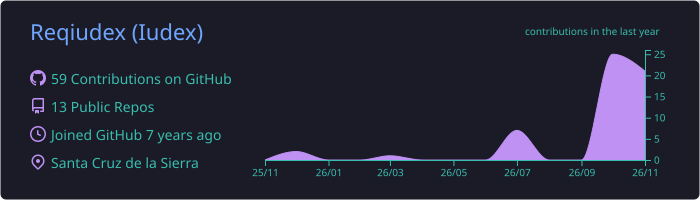
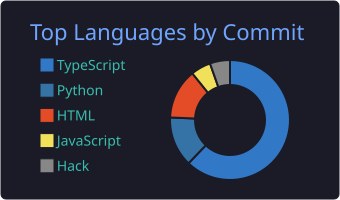
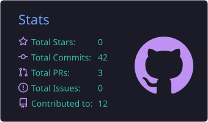

<!-- Encabezado animado -->

 

---

## 👨‍💻 Sobre mí

- 🎓 **Ingeniero de Sistemas** con título universitario.
- 📜 **Diplomado 2026** — sistema de compra-venta, inventario y Kardex (FastAPI + React + PostgreSQL).
- 🏗️ Diseño y despliego **sistemas completos**: desde la base de datos hasta el servidor y el dominio en producción.
- 🤖 Uso la **IA como herramienta de ingeniería**: integro modelos de lenguaje en productos (APIs de LLM, modelos locales con Ollama) y la aplico para acelerar desarrollo, revisión y documentación **sin ceder el control** de las decisiones críticas.
- 💬 Creo **bots de IA** para WhatsApp, web y Telegram, y **mensajería masiva en WhatsApp** con la **API oficial de WhatsApp Business (Meta)**: plantillas aprobadas, campañas segmentadas y recordatorios automáticos.
- 🖥️ Años de experiencia **ensamblando computadoras y servidores**, desde PCs a medida hasta servidores Linux con virtualización.
- 🔐 Me importa la **seguridad**: auditorías, cabeceras HTTP, CSP, manejo de secretos y principio de mínimo privilegio.
- 🌱 Ahora mismo: construyendo **NPC Factory**, una plataforma para que cualquiera cree juegos y mods con IA.

 

---

## 🛠️ Tecnologías

**Lenguajes**

**Frontend**

**Backend y datos**

**DevOps e infraestructura**

**Inteligencia artificial**

---

## ✅ Cómo trabajo

| Práctica | En la práctica |
|---|---|
| 🧱 **Arquitectura y patrones** | Capas bien separadas, principios SOLID y patrones de diseño (Proxy, Repository, Strategy…) |
| 🧪 **Pruebas** | Tests unitarios y de integración antes de dar algo por terminado |
| 🔁 **CI/CD** | GitHub Actions (formato, lint, tests, build) y despliegue continuo con Coolify |
| 🐳 **Contenedores** | Imágenes Docker multi-etapa, mínimas y sin root; healthchecks en cada servicio |
| 🔐 **Seguridad** | Secretos fuera del repo, CSP y cabeceras seguras, auditorías periódicas, backups |
| 📚 **Documentación** | README, guías de despliegue y decisiones de arquitectura registradas |
| 🌿 **Git ordenado** | Ramas por funcionalidad, commits descriptivos e historial limpio |
| 🤖 **IA responsable** | La IA sugiere; las decisiones de dinero, permisos y seguridad las define el código y una persona |

---

## 🚀 Proyectos destacados

<table>
<tr>
<td width="50%" valign="top">

### 🚚 Sistema Flete Ensilados
**Proyecto de grado — Ingeniería de Sistemas**

Plataforma para *Ensilados Santa Cruz*: catálogo, pedidos, **cálculo automático de flete por geolocalización**, pago con QR y panel administrativo.

`TypeScript` `Supabase` `Docker`

[📂 Repositorio](https://github.com/Reqiudex/Sistema-Flete-Ensilados) · [🌐 Demo](https://tesis.cherry.lat)

</td>
<td width="50%" valign="top">

### 💳 Pasarela de Pagos
**Backend en Rust**

Pasarela propia con **pagos QR**, webhooks firmados, panel de administración y saldo calculado desde un *ledger* contable.

`Rust` `PostgreSQL` `Docker`

🔒 Repositorio privado

</td>
</tr>
<tr>
<td width="50%" valign="top">

### 🎮 NPC Factory
**IA + juegos (en desarrollo)**

Plataforma para que personas sin experiencia creen juegos y mods con ayuda de **IA**. API en Rust (axum + sqlx), web en SvelteKit y almacenamiento S3.

`Rust` `SvelteKit` `IA` `MinIO`

🔒 Repositorio privado

</td>
<td width="50%" valign="top">

### 🌾 Kardex de Silos — Diplomado
**Diplomado 2026**

Compra-venta, **inventario estricto y Kardex** para silos de maíz y sorgo.

`FastAPI` `React` `PostgreSQL` `Docker`

📂 Proyecto académico

</td>
</tr>
<tr>
<td width="50%" valign="top">

### 🛡️ Patrón Proxy — Demo
**Patrones de diseño**

Cadena de proxies (logging, protección por roles y caché con TTL) en Python y en una web interactiva, con 9 pruebas automáticas.

`Python` `JavaScript` `nginx`

[🌐 Demo en vivo](https://proxytest.cerice360.com)

</td>
<td width="50%" valign="top">

### 🌐 Cerice360
**Sitio y plataforma web**

Sitio principal con despliegue continuo, registro de errores en Supabase y entrega por Cloudflare.

`HTML` `Supabase` `Cloudflare`

[🌐 cerice360.com](https://cerice360.com)

</td>
</tr>
</table>

---

## 📊 Estadísticas

---

### 🤝 ¿Trabajamos juntos?

Desarrollo web a medida, sistemas, **bots de IA**, **WhatsApp masivo con la API de Meta**, pasarelas de pago QR, servidores y ensamblaje de equipos.

